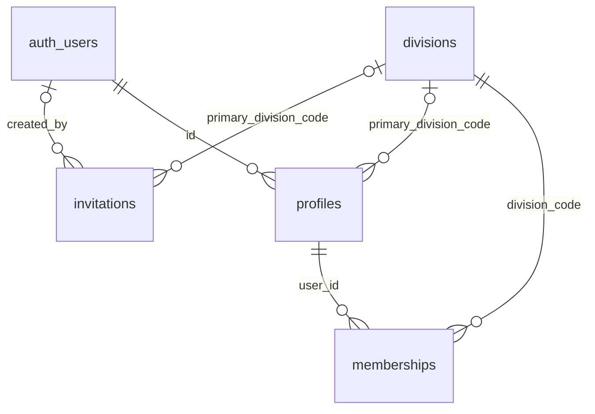
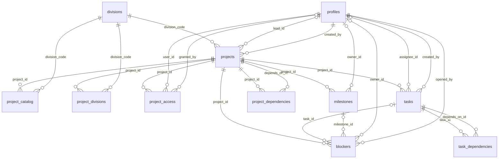
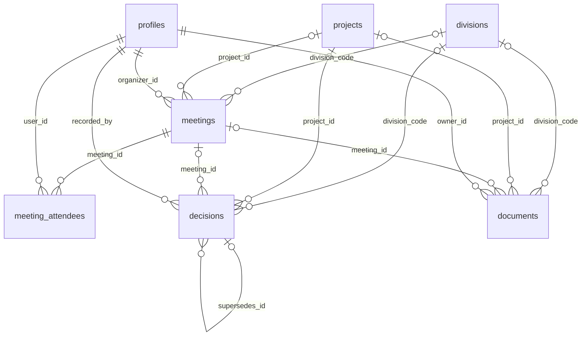
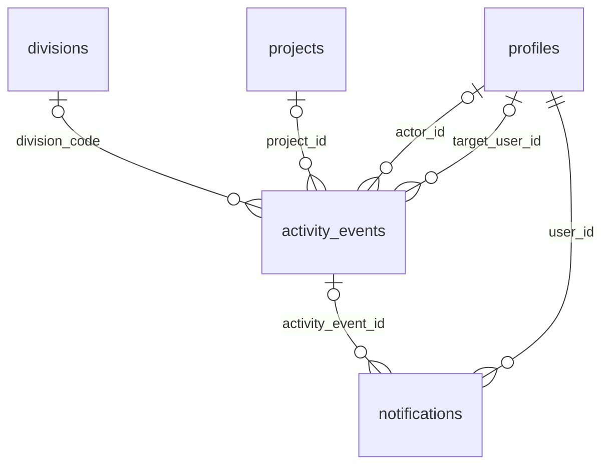
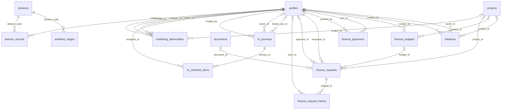
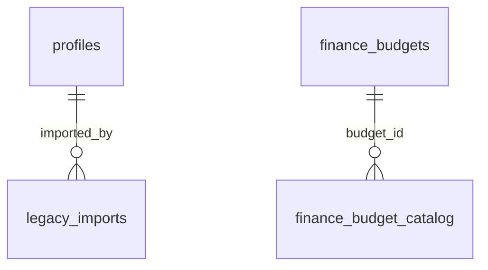

# Database relations

Generated by `bin/generate-db-relations.mjs` from the `references` clauses in `database/migrations/*.sql`. Do not edit by hand; re-run the script after adding a migration. The SQL files remain the source of truth.

32 tables, 78 foreign keys, 4 migrations.

## Table groups

- **Identity and access:** `divisions`, `invitations`, `profiles`, `memberships`
- **Projects and work:** `projects`, `project_catalog`, `project_divisions`, `project_access`, `tasks`, `task_dependencies`, `project_dependencies`, `milestones`, `blockers`
- **Meetings, decisions, documents:** `meetings`, `meeting_attendees`, `decisions`, `documents`
- **Activity and notifications:** `activity_events`, `notifications`
- **Division workflows:** `workflow_stages`, `initiatives`, `finance_budgets`, `finance_approvers`, `finance_requests`, `finance_request_history`, `hr_journeys`, `hr_checklist_items`, `marketing_deliverables`, `division_records`
- **Admin, import and catalog:** `legacy_imports`, `finance_budget_catalog`

Also present: the `public.finance_budget_summary` view (migration 202609230003) and `private.bootstrap_settings`, which holds the first-administrator setting described in `database/README.md`.

## Diagram

A solid line marks a required reference (`not null`); a line with a circle marks an optional one. Read each line as parent → child.

```mermaid
erDiagram
  divisions |o--o{ invitations : "primary_division_code"
  auth_users |o--o{ invitations : "created_by"
  auth_users ||--o{ profiles : "id"
  divisions |o--o{ profiles : "primary_division_code"
  profiles ||--o{ memberships : "user_id"
  divisions ||--o{ memberships : "division_code"
  divisions ||--o{ projects : "division_code"
  profiles |o--o{ projects : "lead_id"
  profiles ||--o{ projects : "created_by"
  projects ||--o{ project_catalog : "project_id"
  divisions ||--o{ project_catalog : "division_code"
  projects ||--o{ project_divisions : "project_id"
  divisions ||--o{ project_divisions : "division_code"
  projects ||--o{ project_access : "project_id"
  profiles ||--o{ project_access : "user_id"
  profiles |o--o{ project_access : "granted_by"
  projects ||--o{ tasks : "project_id"
  profiles |o--o{ tasks : "assignee_id"
  profiles ||--o{ tasks : "created_by"
  tasks ||--o{ task_dependencies : "task_id"
  tasks ||--o{ task_dependencies : "depends_on_id"
  projects ||--o{ project_dependencies : "project_id"
  projects ||--o{ project_dependencies : "depends_on_id"
  projects ||--o{ milestones : "project_id"
  profiles |o--o{ milestones : "owner_id"
  projects ||--o{ blockers : "project_id"
  tasks |o--o{ blockers : "task_id"
  milestones |o--o{ blockers : "milestone_id"
  profiles |o--o{ blockers : "owner_id"
  profiles ||--o{ blockers : "opened_by"
  divisions |o--o{ meetings : "division_code"
  projects |o--o{ meetings : "project_id"
  profiles ||--o{ meetings : "organizer_id"
  meetings ||--o{ meeting_attendees : "meeting_id"
  profiles ||--o{ meeting_attendees : "user_id"
  divisions |o--o{ decisions : "division_code"
  projects |o--o{ decisions : "project_id"
  meetings |o--o{ decisions : "meeting_id"
  decisions |o--o{ decisions : "supersedes_id"
  profiles ||--o{ decisions : "recorded_by"
  divisions |o--o{ documents : "division_code"
  projects |o--o{ documents : "project_id"
  meetings |o--o{ documents : "meeting_id"
  profiles ||--o{ documents : "owner_id"
  divisions |o--o{ activity_events : "division_code"
  projects |o--o{ activity_events : "project_id"
  profiles |o--o{ activity_events : "actor_id"
  profiles |o--o{ activity_events : "target_user_id"
  profiles ||--o{ notifications : "user_id"
  activity_events |o--o{ notifications : "activity_event_id"
  divisions ||--o{ workflow_stages : "division_code"
  projects |o--o{ initiatives : "project_id"
  profiles |o--o{ initiatives : "owner_id"
  profiles ||--o{ initiatives : "created_by"
  projects |o--o{ finance_budgets : "project_id"
  profiles ||--o{ finance_budgets : "created_by"
  profiles ||--o{ finance_approvers : "user_id"
  profiles |o--o{ finance_approvers : "granted_by"
  finance_budgets |o--o{ finance_requests : "budget_id"
  projects |o--o{ finance_requests : "project_id"
  documents |o--o{ finance_requests : "document_id"
  profiles ||--o{ finance_requests : "requester_id"
  profiles |o--o{ finance_requests : "approver_id"
  finance_requests ||--o{ finance_request_history : "request_id"
  profiles |o--o{ finance_request_history : "actor_id"
  profiles |o--o{ hr_journeys : "linked_user_id"
  profiles |o--o{ hr_journeys : "owner_id"
  profiles ||--o{ hr_journeys : "created_by"
  hr_journeys ||--o{ hr_checklist_items : "journey_id"
  profiles |o--o{ hr_checklist_items : "assignee_id"
  projects |o--o{ marketing_deliverables : "project_id"
  profiles |o--o{ marketing_deliverables : "owner_id"
  profiles |o--o{ marketing_deliverables : "reviewer_id"
  profiles ||--o{ marketing_deliverables : "created_by"
  divisions ||--o{ division_records : "division_code"
  profiles ||--o{ division_records : "created_by"
  profiles ||--o{ legacy_imports : "imported_by"
  finance_budgets ||--o{ finance_budget_catalog : "budget_id"
```

## By feature

One diagram per table group: the group's own tables plus the outside tables they point to.

### Identity and access

Tables: `divisions`, `invitations`, `profiles`, `memberships`

### Projects and work

Tables: `projects`, `project_catalog`, `project_divisions`, `project_access`, `tasks`, `task_dependencies`, `project_dependencies`, `milestones`, `blockers`

### Meetings, decisions, documents

Tables: `meetings`, `meeting_attendees`, `decisions`, `documents`

### Activity and notifications

Tables: `activity_events`, `notifications`

### Division workflows

Tables: `workflow_stages`, `initiatives`, `finance_budgets`, `finance_approvers`, `finance_requests`, `finance_request_history`, `hr_journeys`, `hr_checklist_items`, `marketing_deliverables`, `division_records`

### Admin, import and catalog

Tables: `legacy_imports`, `finance_budget_catalog`

## Foreign keys

| Table | Column | References | Required | On delete |
|---|---|---|---|---|
| invitations | primary_division_code | divisions.code | no | no action |
| invitations | created_by | auth_users.id | no | no action |
| profiles | id | auth_users.id | yes | cascade |
| profiles | primary_division_code | divisions.code | no | no action |
| memberships | user_id | profiles.id | yes | cascade |
| memberships | division_code | divisions.code | yes | no action |
| projects | division_code | divisions.code | yes | no action |
| projects | lead_id | profiles.id | no | no action |
| projects | created_by | profiles.id | yes | no action |
| project_catalog | project_id | projects.id | yes | cascade |
| project_catalog | division_code | divisions.code | yes | no action |
| project_divisions | project_id | projects.id | yes | cascade |
| project_divisions | division_code | divisions.code | yes | no action |
| project_access | project_id | projects.id | yes | cascade |
| project_access | user_id | profiles.id | yes | cascade |
| project_access | granted_by | profiles.id | no | no action |
| tasks | project_id | projects.id | yes | cascade |
| tasks | assignee_id | profiles.id | no | no action |
| tasks | created_by | profiles.id | yes | no action |
| task_dependencies | task_id | tasks.id | yes | cascade |
| task_dependencies | depends_on_id | tasks.id | yes | cascade |
| project_dependencies | project_id | projects.id | yes | cascade |
| project_dependencies | depends_on_id | projects.id | yes | cascade |
| milestones | project_id | projects.id | yes | cascade |
| milestones | owner_id | profiles.id | no | no action |
| blockers | project_id | projects.id | yes | cascade |
| blockers | task_id | tasks.id | no | set null |
| blockers | milestone_id | milestones.id | no | set null |
| blockers | owner_id | profiles.id | no | no action |
| blockers | opened_by | profiles.id | yes | no action |
| meetings | division_code | divisions.code | no | no action |
| meetings | project_id | projects.id | no | cascade |
| meetings | organizer_id | profiles.id | yes | no action |
| meeting_attendees | meeting_id | meetings.id | yes | cascade |
| meeting_attendees | user_id | profiles.id | yes | cascade |
| decisions | division_code | divisions.code | no | no action |
| decisions | project_id | projects.id | no | cascade |
| decisions | meeting_id | meetings.id | no | set null |
| decisions | supersedes_id | decisions.id | no | set null |
| decisions | recorded_by | profiles.id | yes | no action |
| documents | division_code | divisions.code | no | no action |
| documents | project_id | projects.id | no | cascade |
| documents | meeting_id | meetings.id | no | set null |
| documents | owner_id | profiles.id | yes | no action |
| activity_events | division_code | divisions.code | no | no action |
| activity_events | project_id | projects.id | no | cascade |
| activity_events | actor_id | profiles.id | no | no action |
| activity_events | target_user_id | profiles.id | no | no action |
| notifications | user_id | profiles.id | yes | cascade |
| notifications | activity_event_id | activity_events.id | no | cascade |
| workflow_stages | division_code | divisions.code | yes | no action |
| initiatives | project_id | projects.id | no | set null |
| initiatives | owner_id | profiles.id | no | no action |
| initiatives | created_by | profiles.id | yes | no action |
| finance_budgets | project_id | projects.id | no | set null |
| finance_budgets | created_by | profiles.id | yes | no action |
| finance_approvers | user_id | profiles.id | yes | cascade |
| finance_approvers | granted_by | profiles.id | no | no action |
| finance_requests | budget_id | finance_budgets.id | no | set null |
| finance_requests | project_id | projects.id | no | set null |
| finance_requests | document_id | documents.id | no | set null |
| finance_requests | requester_id | profiles.id | yes | no action |
| finance_requests | approver_id | profiles.id | no | no action |
| finance_request_history | request_id | finance_requests.id | yes | cascade |
| finance_request_history | actor_id | profiles.id | no | no action |
| hr_journeys | linked_user_id | profiles.id | no | no action |
| hr_journeys | owner_id | profiles.id | no | no action |
| hr_journeys | created_by | profiles.id | yes | no action |
| hr_checklist_items | journey_id | hr_journeys.id | yes | cascade |
| hr_checklist_items | assignee_id | profiles.id | no | no action |
| marketing_deliverables | project_id | projects.id | no | set null |
| marketing_deliverables | owner_id | profiles.id | no | no action |
| marketing_deliverables | reviewer_id | profiles.id | no | no action |
| marketing_deliverables | created_by | profiles.id | yes | no action |
| division_records | division_code | divisions.code | yes | no action |
| division_records | created_by | profiles.id | yes | no action |
| legacy_imports | imported_by | profiles.id | yes | no action |
| finance_budget_catalog | budget_id | finance_budgets.id | yes | cascade |
